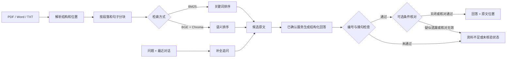

# 知页 · AI 知识库助手

上传 PDF、Word 或 TXT 后，可以围绕文档连续提问，并回到原文核对答案。页面提供一份虚构员工手册，不准备文件也能体验完整流程。

项目重点解决文档问答的可核查与数据流向可控：保留 PDF 页码和 Word 段落位置，兼顾关键词与同义表达检索，以及避免模型把不存在的原文写成引用。资料不够、检索无结果和模型输出异常会显示为不同状态，方便判断下一步该补文档、换问法还是重试。

**在线体验：** [在 Streamlit Cloud 打开知页](https://ai-knowledge-assistant-qujnzjhmdavaeachd75gvp.streamlit.app/)

**本次本地迭代尚未同步在线体验。**

## 目前完成

- 支持 PDF、Word、TXT，保留文件名、PDF 物理页码、Word 段落或表格行位置。
- 提供 BM25 关键词检索和本地 BGE-small-zh-v1.5 语义检索，可在当前文档中切换并复用索引。
- 支持最近三轮有效问答的追问补全；页面显示改写后的完整问题，历史回答不作为新答案的证据。
- 模型返回结构化答案、来源编号和连续原文摘句，程序核对后再展示为已回答。
- 可选择最多六处候选原文，以及同服务回答条件核对；发现有依据的遗漏时暂不展示为可靠答案。
- 可在每次模型发送前查看完整发送文本并确认，前序请求结果在会话内复用。
- 会话内保留问答和状态，支持 Markdown 导出；切换文档与清空记录需要显式确认。
- 支持部署者配置多个 HTTPS Chat Completions 兼容模型服务；提问前展示接收方和数据范围，切换文档或服务后重新确认，失败不跨服务回退。
- 每轮保存实际服务、模型及调用编号，可导出不含正文和密钥的会话调用元数据。
- 可按文档禁止模型调用，仍可关键词检索原文；历史问答可选择不发送，发送范围变化后需要重新确认。
- 116 项离线自动测试通过（110 项文档、问答、服务控制与云端配置测试，以及 6 项向量检索测试），覆盖发送许可、服务路由、重定向阻断和元数据内容。20 道虚构政策开发题最终通过预设状态与事实字符串检查；该数据集参与过调试，因此只用于回归检查。

## 工作流程



## 几个关键取舍

### 分块先尊重文档结构

分块上限为 400 字符。程序优先保留完整段落，长段落再按句子拆分，相邻块最多重叠 60 字符。这样比固定字符切割更容易保留一条制度的条件和结论，但复杂表格、多栏 PDF 和跨段规则仍可能被拆开。

### 两种检索各有用途

BM25 对条款名、数字和原文词语更直接，也不需要下载模型。语义检索使用本地 BGE-small-zh-v1.5 和 Chroma，更适合同义改写。向量只负责候选片段排序；项目没有用未经校准的相似度阈值直接判断能否回答。

向量计算在运行应用的机器上完成，选中的原文片段（含文件名、位置）和问题仍会发送给用户确认的服务生成回答。追问改写还会发送最近三轮有效问题和回答。短文档可能完整进入候选片段。首次使用语义检索需要下载模型到 `.model_cache/`。

### 引用由程序核对

模型需要返回 `answerable`、答案、来源编号和连续原文摘句。程序检查 JSON 格式、编号是否属于本轮候选来源，以及摘句是否真实存在于对应片段。检查失败时，拟生成的答案不会被当成已核验结果展示。

这项检查能发现编造编号或不存在的摘句，但不能保证模型对真实摘句的解释一定正确，也不能发现所有条件遗漏。

### 追问只补全问题

追问会先改写成可以独立检索的问题，再重新检索当前文档。例如“那试用期员工呢？”会补全为包含当前讨论主题的问题。历史答案只用于理解省略和指代，不会直接放进本轮证据。普通首轮通常调用一次回答服务；有历史的追问通常还需要一次改写调用。

### 状态要能解释失败位置

- `answered`：回答、来源编号和原文摘句均通过检查。
- `no_match`：关键词检索没有候选结果，跳过回答请求。
- `insufficient`：找到了候选内容，但不足以回答。
- `unverified`：回答或核对格式、来源编号、摘句检查未通过，或条件核对发现可能遗漏。
- `error`：服务调用或追问改写失败。

模型返回空正文或因长度上限被截断时会标记为服务错误，不会误报为文档没有答案。

## 本地运行

```bash
python -m venv .venv
source .venv/bin/activate
python -m pip install -r requirements.txt
cp .env.example .env
python -m streamlit run app.py
```

默认可在 `.env` 中填写腾讯 MaaS 的 API 密钥和地址，模型默认 `hy3`。多服务部署时，复制 `model_services.example.json` 为部署者自己的配置文件，并将 `.env` 中 `MODEL_SERVICES_CONFIG` 指向其绝对路径。每项填写实际服务地址、模型名称、提供方和密钥环境变量名称；密钥只放在环境变量或部署平台的秘密配置中。示例中的两个地址是占位符，必须替换后才能调用。

页面只列出部署配置中的服务，不允许用户上传模型地址。接口需支持 `/chat/completions`、文本消息和 JSON 格式返回；这不代表支持所有主流模型协议。`thinking_disabled` 仅用于支持该参数的服务。程序拒绝 HTTP、地址内账号、查询参数、片段和重定向，也不会在服务失败时自动更换接收方。

上传前页面说明文件先进入应用服务器。未配置服务或未确认当前文档接收方时，文档仍可解析，提问入口保持禁用。确认覆盖当前文档以及用户选定的历史发送范围，不表示已取得企业授权。

当前文档可以设为“禁止发送给模型服务”。这个限制同时作用于界面和会话模型调用层，阻止回答与追问改写请求；解除禁止后仍需重新确认。用户仍可通过“仅检索原文”使用 BM25 查询候选片段，该入口不调用模型，也不加载向量模型。用户关闭“允许发送历史问答以理解追问”后，后续问题直接作为独立问题检索，应补全主题和条件；页面保留历史记录。改变历史发送范围会撤回旧许可。禁止发送不能撤回之前的请求，也不阻止文件上传到应用服务器。限制保存在当前会话，不能代替企业文档分级或账号权限策略。

改良的需求、取舍和验收标准见 [数据发送控制说明](docs/data-controls.md)。

调用追溯仅保存于浏览器对应的服务器会话内存，可导出 JSON，记录应用生成的调用 UUID、UTC 时间、部署者声明的提供方、地址、模型、文档摘要标识、片段摘要标识、调用阶段与成功/错误状态。这里的摘要标识是 SHA-256，不是正文摘要；哈希也不是匿名化保证。提供方身份与返回内容未经过独立认证。调用 UUID 用于关联应用内记录，不是服务商请求编号。

没有持久化或不可篡改日志，刷新可能丢失；清空调用元数据后，问答里的编号仍保留但无法在页面找到对应记录。调用记录本身也可能揭示使用时间、内部服务地址和文档指纹，请按内部数据规则保存。问答 Markdown 另外包含问题、回答与来源正文。CLI 的 `call_llm` 保留腾讯环境配置的显式调用方式；在线开发评测改为必须指定批准服务并显式允许发送，不继承浏览器会话内的文档禁止状态。调用元数据额外记录每次请求耗时，以及服务实际返回的非负整数 Token 用量；未返回时不估算。

## 测试与开发评测

```bash
# 自动测试，不调用付费 API
python -m unittest discover -v

# 默认只评估检索，不调用回答服务
python evaluation/run.py --mode keyword --output evaluation/keyword-retrieval.json

# 指定服务并明确允许发送，才运行在线回答评测（会产生 API 费用）
# tencent 是默认服务 ID；自定义部署时使用服务清单中的 ID
python evaluation/run.py --mode semantic --answers --service tencent --allow-model-send --output evaluation/new-service-answers.json --markdown-output evaluation/new-service-answers.md
```

新评测报告同时记录服务与模型、数据集指纹、逐题调用编号、引用核验状态、服务错误、耗时及 Token 统计覆盖范围。可读报告只列统计与逐题状态；JSON 另含评测问题、回答和调用元数据，分享前应检查内部服务地址。不同模型比较需固定同一数据集、检索方式和代码版本，多次重复并人工复核。

开发集包含 14 道有答案题、4 道资料缺失题和 2 道资料冲突题。最终一次运行中，14 道题给出回答，6 道返回资料不足；单题耗时中位数约 1.8 秒。程序只检查预设状态和事实字符串，问题也参与过调试，所以 **20/20 不代表产品准确率**。完整迭代记录见 [evaluation/README.md](evaluation/README.md)。

另外有一组 6 题的小范围检索对照：关键词检索让正确段落在 2/6 的问题中排第一、2/6 进入前三；语义检索为 4/6 排第一、6/6 进入前三。短文档和小样本只能帮助定位检索差异，不能代表长文档效果。

GitHub Actions 会在推送和 Pull Request 时安装依赖、运行全部测试并检查 Python 语法，不配置 API 密钥，也不调用在线回答服务。

## 新增验证材料

- [20 题合成挑战集](evaluation/challenge_cases.json)：覆盖条件例外、审批边界、冲突、跨段证据与干扰指令。初建时未据此调整问答算法；目前已用于长文证据与条件核对开发，不能称盲测或真实用户基准。
- [DeepSeek 接入与对照步骤](docs/deepseek-setup.md)：保留现有混元服务，增加第二服务；已完成 2026-10-07 单次在线联调；配置不代表企业批准服务。
- [人工复核表](evaluation/challenge-human-review.md)：补充字符串检查无法判断的条件遗漏和错误解释。
- [3—5 人任务测试方案](docs/user-study.md)：数据去向、发送限制、原文查询、服务切换与历史控制；尚未招募或采集用户反馈。

## 快速体验

打开内置的虚构员工手册后，可以先提问“正式员工每年有几天年假”，再追问“那试用期员工呢”，最后询问文档没有写到的午餐政策。这组问题依次覆盖原文定位、多轮追问和资料不足处理。

## 当前边界

- 会话记录和文档索引保存在当前会话内存中，刷新、断开或服务重启后可能丢失；目前没有账号与跨设备同步。
- 扫描图片 PDF 没有 OCR；复杂 PDF 的多栏和表格阅读顺序可能不准确。
- Word 当前读取正文段落和顶层表格，不包含页眉、页脚、批注和文本框。
- 语义模型首次下载体积较大，仓库不提交 `.model_cache/`。
- 服务选择和确认用于控制本应用的发送行为，不证明服务商安全，也不能凭调用记录判定泄漏责任；没有用户登录、管理员权限校验、文档分级或脱敏。
- 上生产前还需要独立长文档评测、权限隔离、持久化、限流、监控和数据保留策略。

## 代码结构

- `documents.py`：文件读取、原文位置和分块。
- `retrieval.py`：BM25 关键词检索。
- `vector_retrieval.py`：本地向量模型与 Chroma 索引。
- `model_services.py`：部署服务配置、发送许可、统一请求与会话调用元数据。
- `rag_core.py`：追问补全、检索和回答流程。
- `grounding.py`：结构化输出与原文摘句检查。
- `answer_checks.py`：拒答指引与可选条件模型核对。
- `send_preview.py`：逐次确认与会话内请求结果复用。
- `conversation.py`：文档会话、结果保存和导出。
- `app.py`：Streamlit 界面与会话状态。
- `evaluation/`：20 道开发题、运行程序和历史结果。

### 双模型联调与错误反馈（2026-10-07）

相同的 20 道虚构挑战题单次运行，混元预设检查通过 19/20，DeepSeek 17/20，两组各 22 次调用均返回有效正文。分数不是产品准确率；复核发现审批条件遗漏和长文跨段检索不足。见[对照报告](evaluation/model-comparison-2026-10-07.md)和[复核记录](evaluation/model-review-2026-10-07.md)。

模型调用失败显示对应的本地处理提示，覆盖密钥、计费、权限、限流、网络和返回异常。元数据仅记录错误类别与 HTTP 状态，不展示服务错误正文，不自动重试或切换模型。

### 条件完整性回归（2026-10-07）

回答生成增加与用户操作相关的审批、资格、期限和限制提示，并区分无法承诺个人结果与可以解释原文规则。新增 8 道虚构回归题，单次混元检查通过 8/8，DeepSeek 7/8；DeepSeek 延期追问仍遗漏批准条件。引用核验不能保证条件完整性。见[迭代与复核记录](evaluation/conditions-review-2026-10-07.md)及[同版双模型报告](evaluation/conditions-comparison-2026-10-07.md)。没有修改检索与引用验证。

### 信任流程与重复验证（2026-10-07）

已补充有限证据范围、可选条件核对、拒答指引和逐次发送预览。四道已知回归题各服务三轮，混元完成 12/12 题次，DeepSeek 完成 8/12，另四次因条件遗漏被拦截；各 33 次调用正常返回。不是独立正确率或真实用户结果。见[产品取舍与边界](docs/trust-workflow.md)、[修正后重复汇总](evaluation/trust-repeated-corrected-2026-10-07/reporting-corrected/summary.md)。真实用户测试仅准备了方案与空白记录，尚未执行。

## 试用部署说明

2026-10-18 版本用于功能演示与受邀试用，尚无真实用户效果数据。建议使用虚构样例或公开文档，不要上传企业内部材料或个人敏感信息。

Streamlit Community Cloud 使用 `app.py`，建议 Python 3.13。单服务可在 Settings → Secrets 设置根级的 `TENCENT_API_KEY`、`TENCENT_API_BASE_URL` 和 `TENCENT_MODEL`；多服务可把批准清单 JSON 数组写成 `MODEL_SERVICES_JSON` 字符串，并分别设置清单引用的密钥变量。内联配置优先于 `MODEL_SERVICES_CONFIG` 本机路径，配置无效时停止加载，不回退到其他服务。清单格式见 `model_services.example.json`，示例地址必须替换。

不要提交真实密钥、`.env`、`model_services.json` 或 `.streamlit/secrets.toml`。首次语义检索会下载本地向量模型，启动慢时可先体验 BM25。会话隔离不等于企业权限管理，公开访问前应设置服务商预算与告警；本项目尚未提供账号或服务级费用上限。
